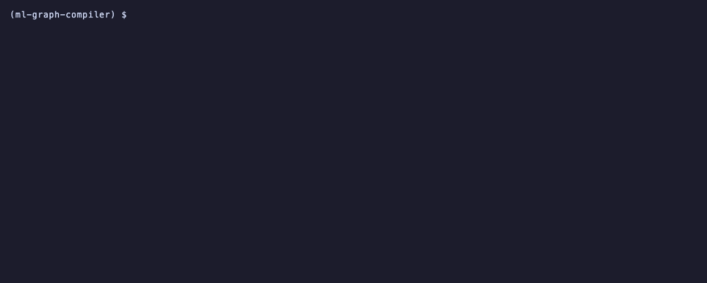

<h1 align="center">ML Graph Compiler</h1>

<p align="center">
  <em>A compiler that turns a trained neural network, saved in the Open Neural Network Exchange (ONNX) format, into fast native code for one computer.</em>
</p>

<p align="center">
  <a href="https://github.com/adeoluo/ml-graph-compiler/actions/workflows/ci.yml"></a>
  <a href="https://github.com/adeoluo/ml-graph-compiler/releases"></a>
  
  
  <a href="LICENSE"></a>
</p>

---

> **Evidence level: publicly benchmarked.** The compiled models give the same outputs as ONNX Runtime (ORT), Microsoft's widely used engine for running ONNX models, apart from tiny rounding differences. This was checked on 3,925 images from Imagenette, a 10-class subset of the ImageNet photo collection. It was also checked on 6,400 token positions (word pieces of the input text) for each of two text models, BERT and GPT-2. Speed was compared with ONNX Runtime and with PyTorch (a popular machine learning framework) on a single Apple M1 laptop. No one else has reproduced these results, and the compiler is not used in production.

## Highlights

A trained AI model is a long recipe of math steps. This project is a compiler: it takes that
recipe and turns it into fast code for one machine. It does the same job as ONNX Runtime and is
measured against it. The tests use four well-known neural networks: ResNet-50 and MobileNetV2,
which classify images, and BERT-base and GPT-2, which process text.

- **It gives the same answers as ONNX Runtime.** On all 3,925 test images, both compiled image
  models pick the same top class as ONNX Runtime. Both text models also agree with ONNX Runtime
  at all 6,400 token positions.
- **With 8 threads, it is faster than ONNX Runtime on three of the four models.** A thread is
  one stream of work, and the test laptop has 8 processor cores. The compiled code is 1.23x to
  1.37x faster on ResNet-50, BERT-base and GPT-2, and it ties on MobileNetV2.
- **It needs much less scratch memory.** Intermediate results (tensors, the arrays of numbers
  passed between steps) share one block of memory. For GPT-2, the memory planner shrinks this
  block from 113.6 MB, when every tensor gets its own space, to 3.0 MB.
- **It uses no outside library for matrix math.** The core matrix multiplication is written by
  hand for Arm processors with NEON, the Arm instructions that process several numbers at once.
  Other processors use a portable C version.

**Where it falls short:** With 1 thread or with 4 threads, ONNX Runtime is faster on all four
models, by 1.05x to 1.38x. With 1 thread, PyTorch is 3.64x to 5.56x faster than this compiler
on ResNet-50, BERT-base and GPT-2. All timings come from one Apple M1 laptop. Its 8 cores are of
two kinds: 4 fast performance cores and 4 slower efficiency cores. The 8-thread advantage may
depend on this mix, and it has not been tested on other processors.

## Key terms

Plain definitions of the terms used in this README.

| Term | Meaning |
|---|---|
| Ablation study | An experiment that adds or removes one part at a time, here one optimization pass, to measure what each part contributes. |
| Apple Accelerate and AMX | Accelerate is Apple's built-in math library, which PyTorch uses on macOS. On the M1 it runs matrix multiplications on AMX, special matrix hardware next to the processor cores. |
| Arena | One block of memory, reserved once, that holds all intermediate tensors at fixed positions (offsets). Smaller is better. |
| Confidence interval (CI) | A range that likely contains the true median time, estimated by resampling the measurements (bootstrap). Two results differ only when their 95% ranges do not overlap. |
| GEMM | General matrix multiplication, the core computation of most neural networks. Convolutions are also computed as matrix multiplications here. |
| Imagenette | A 10-class subset of the ImageNet photo collection. Its validation split has 3,925 images. |
| Intermediate representation (IR) | The compiler's internal description of the model: a graph of operators (nodes) and the values that flow between them. |
| Latency | The time for one inference (one run of the model on one input), in milliseconds (ms). Tables report the median of many runs, and lower is better. |
| Layout (NCHW, NHWC) | The order in which image tensors are stored in memory. NCHW stores each channel separately, and NHWC stores all channels of one pixel next to each other. |
| Max abs error | The largest absolute difference between any output number of this compiler and the same number from ONNX Runtime. 0 means identical, and lower is better. |
| MLAS | ONNX Runtime's own library of hand-tuned math routines for the processor. |
| MLIR | Multi-Level Intermediate Representation, a compiler framework from the LLVM project. Its "dialects" are named sets of operations, such as linalg for linear algebra. |
| NEON | The vector instructions of Arm processors, which work on several numbers at once. Apple's M1 chip supports them. |
| ONNX | Open Neural Network Exchange, a common file format for trained models. Most training frameworks can export to it. |
| ONNX Runtime (ORT) | Microsoft's widely used engine for running ONNX models, called onnxruntime in code. It is the reference this project is compared with. |
| OpenMP | A standard way to split loops in C code across several processor cores (threads). |
| Operator fusion | Merging several consecutive operators into one, so intermediate results are not written to memory and read back. |
| Peak live memory | The largest total size of tensors that are needed at the same moment, in MB. For a fixed order of steps, no memory plan can use less, and lower is better. |
| Peak RSS | Peak resident set size: the most RAM the whole process used at one time, in MB. Lower is better. |
| Performance and efficiency cores | The M1 has 4 fast performance cores and 4 slower, power-saving efficiency cores. |
| PyTorch eager | PyTorch in its default mode, which runs the model step by step without compiling it. |
| Speedup (for example 1.37x) | How many times faster one engine is than another: the slower median time divided by the faster one. |
| SSA (static single assignment) | A graph form in which every value is produced by exactly one operator, which makes rewriting the graph safe and simple. |
| Top-1 accuracy | The share of images whose highest-scoring class is the correct label. From 0 to 1, higher is better. |
| Top-1 agreement | The number of inputs (images or token positions) where two engines pick the same highest-scoring output. Higher is better, and the best is all inputs. |

## Motivation

An inference runtime is software that runs a trained model to produce predictions. Examples are
onnxruntime, TVM (an open-source deep learning compiler) and XLA (Google's compiler for machine
learning). They all solve the same problem. They take a dataflow graph exported from a training
framework and turn it into fast code for one machine. A dataflow graph lists the math steps
(operators) and the data that flows between them. The hard part is not the arithmetic. It is the
work in between: deciding which operators to fuse, which memory layout each tensor should use,
in what order to run the nodes, and how to fit every intermediate tensor into as little memory
as possible. All of this must keep the outputs equal to the original model, apart from
floating-point rounding.

This project builds that whole pipeline and measures it on four real networks: ResNet-50,
MobileNetV2, BERT-base and GPT-2. The pipeline has these steps:

1. An ONNX importer builds a typed graph in SSA form. Every shape is fixed in advance (static
   shapes).
2. Optimization passes rewrite the graph. The passes are:
   - constant folding, which computes ahead of time any step whose inputs are already known
   - dead code elimination, which removes unused steps
   - common subexpression elimination (CSE), which merges repeated identical steps
   - algebraic simplification, which replaces steps with simpler equivalent ones
   - operator fusion
   - a layout pass from NCHW to NHWC
   - loop fusion, which merges chains of element-by-element steps into one loop
3. A memory-aware scheduler chooses the order of the steps. A static planner then packs every
   tensor into one arena.
4. The backend generates C code with a NEON matrix multiplication kernel (a GEMM micro-kernel)
   and OpenMP. clang (a C compiler) builds it, and Python loads it through ctypes (Python's
   built-in way to call C code).

A numpy interpreter (a simple executor written with the numpy array library) can run any graph
and serves as the reference. An MLIR export writes the graph as linalg operations on tensors. It
is checked with the `mlir-opt` tool and can be lowered to LLVM (a common compiler back end) and
run.

## Architecture

<p align="center">
  
</p>

<sub>Legend: amber marks entry points and external systems, indigo marks core logic, green marks data and state, blue marks validation and control, and grey marks observability and outputs.</sub>

A model enters through the `mgc` command-line tool (CLI) or through the Python library. The
**frontend** reads the ONNX file, which is stored in protobuf (Google's binary data format), and
turns it into SSA values and nodes. Shape inference then gives every value a fixed shape and data
type (dtype). It uses one operator table, which also holds the numpy definition of each operator.
The **optimizer** runs a named pipeline of passes, from `O0` (no passes) to `O3` (all passes).
After each pass, the graph is checked for valid SSA form, node order and use lists. The
**scheduler** picks a node order meant to lower peak live memory. The **memory planner** works out
when each tensor is alive (liveness) and assigns it a position (offset) in the arena. Where it is
safe, an output reuses the memory of an input (in-place reuse). The **backends** do one of three
things: run the graph with numpy, print it as MLIR, or generate one C function. That C function
uses fixed offsets into the arena and a packed block of weights. clang compiles it into a shared
library, which is cached for reuse. [docs/ARCHITECTURE.md](docs/ARCHITECTURE.md) describes each
stage in detail. The design choices are in the [ADRs](docs/adr/) (architecture decision records).

## Results

All numbers below come from one Apple M1 laptop (8 cores, 8 GB of memory, macOS). Every run used
32-bit floating-point numbers (float32) and one input at a time (batch 1). Images were 224x224
pixels and text inputs were 128 tokens long. The scripts in [`benchmarks/`](benchmarks/) produced
the numbers, and the raw results are in [`benchmarks/results/`](benchmarks/results/). The command
`uv run python benchmarks/tables.py` prints every table in this section from those files. uv is
a Python package and project manager. Library versions: numpy 2.5.4, onnx 1.23.2, onnxruntime
1.31.1 (CPU execution provider, so it runs on the processor only), PyTorch 2.15.0, torchvision
0.29.2 (PyTorch's image model library) and transformers 5.22.2 (Hugging Face's library of text
models). torchvision and transformers were used for the model exports and the PyTorch
comparisons. The C compiler was Apple clang 21 with libomp (the OpenMP library) from Homebrew (a
macOS package manager). [docs/EVALUATION_REPORT.md](docs/EVALUATION_REPORT.md) is the full
write-up. It includes threats to validity, the factors that could make these results misleading.

### Numerical parity with onnxruntime

Each model is compiled at `-O3` with the C backend and compared with onnxruntime on the same ONNX
file. The image models run on the full Imagenette validation split (3,925 ImageNet photos). Each
text model gets 50 random sequences of 128 tokens, made from a fixed random seed so they can be
repeated. That gives 6,400 token positions per text model.
Reproduce: `uv run --group bench python benchmarks/parity.py`.

The table compares the outputs of this compiler (mgc) with onnxruntime. Each row is one model.
The two error columns show how far the outputs differ (lower is better), and the last two columns
count matching or correct predictions (higher is better).

| Model | Inputs | Max abs error | Mean abs error | Top-1 agreement | Top-1 accuracy (mgc / ORT) |
|---|---|---:|---:|---:|---:|
| ResNet-50 | 3,925 imagenette2-320 val images | 4.0e-05 | 1.1e-06 | 3,925 / 3,925 | 0.8471 / 0.8471 |
| MobileNetV2 | 3,925 imagenette2-320 val images | 5.0e-05 | 2.5e-06 | 3,925 / 3,925 | 0.7903 / 0.7903 |
| BERT-base | 50 random token ids, seq 128 | 2.9e-05 | 4.6e-07 | 6,400 / 6,400 | n/a |
| GPT-2 | 50 random token ids, seq 128 | 2.2e-04 | 2.2e-05 | 6,400 / 6,400 | n/a |

Every compiled model picks the same top-1 class as onnxruntime for every image and every token
position. The image models also reach the same Imagenette top-1 accuracy as onnxruntime. The
unoptimized graph (`O0`), run by the numpy interpreter, also matches onnxruntime on a subset of
the inputs: 40 images per image model and one sequence per text model. Its max abs error there is
1.5e-05 to 2.6e-04. So both the unoptimized graph and the compiled `-O3` graph are compared with
onnxruntime. The text models are exported with transformers 5.22.2. These graphs differ from the
exports made with transformers 4.57.6: BERT-base has 1,212 ONNX nodes instead of 1,266, and GPT-2
has 2,043 instead of 2,127. Even so, onnxruntime gives bit-identical outputs for the old and new
exports on the 50 sequences. At `-O3`, both exports also compile to the same node and kernel
counts ([`export_transformers5.json`](benchmarks/results/export_transformers5.json),
`benchmarks/compare_exports.py`).

### Latency and peak memory against onnxruntime and PyTorch

Each cell gives the median latency of one inference in milliseconds, with a bootstrap 95%
confidence interval in square brackets. The number in parentheses is the median peak RSS of the
process in MB. Every cell runs in a fresh process. The cells take turns (round robin) for 3
rounds, and the samples from all rounds are pooled. Each round has 30 timed runs for the image
models (convolutional neural networks, or CNNs) and 10 for the text models (transformers).
"onnxruntime" uses all its graph optimizations. "no graph opt" turns them off, so that column
measures only its kernels (the code that computes each operator). A result counts as a win or a
loss only when the two confidence intervals do not overlap.
Reproduce: `uv run --group bench python benchmarks/latency.py --models resnet50 mobilenetv2 --name latency_cnn`
and `... --models bert-base gpt2 --warmup 3 --repeat 10 --name latency_transformers`.

The machine's load average (the average number of processes running or waiting for the
processor over 1 minute) was recorded for every cell:

latency_cnn (latency_cnn): 48 cells, 1 minute load average during the cells min 3.2, median 3.4, max 4.0 (8 cores)
latency_transformers (latency_transformers): 48 cells, 1 minute load average during the cells min 3.0, median 5.0, max 8.2 (8 cores)

The next two tables compare this compiler (mgc) with onnxruntime and PyTorch eager, first with 1
thread and then with 8 threads. Each row is one model and each engine has one column. Lower
times and lower memory are better. The last two columns give the verdict and the speedup of mgc.

Threads = 1: median ms [95% CI] (peak RSS MB)

| Model | mgc (this) | onnxruntime | onnxruntime, no graph opt | PyTorch eager | mgc vs ORT | mgc vs PyTorch |
|---|---:|---:|---:|---:|---|---|
| ResNet-50 | 113.9 [113.8, 114.1] (596) | 101.4 [101.2, 101.6] (285) | 103.3 [103.3, 103.5] (204) | 31.3 [31.2, 31.5] (486) | loss, 1.12x slower | loss, 3.64x slower |
| MobileNetV2 | 13.3 [13.3, 13.3] (138) | 11.6 [11.6, 11.7] (114) | 12.3 [12.3, 12.4] (112) | 14.6 [14.6, 14.7] (323) | loss, 1.15x slower | win, 1.10x |
| BERT-base | 290.9 [290.7, 291.3] (1074) | 256.9 [256.4, 257.9] (957) | 304.3 [304.0, 304.7] (1111) | 52.4 [52.1, 52.5] (668) | loss, 1.13x slower | loss, 5.56x slower |
| GPT-2 | 415.4 [414.6, 415.9] (1592) | 357.2 [356.9, 357.7] (1032) | 399.4 [398.9, 399.6] (1040) | 97.3 [96.4, 100.2] (846) | loss, 1.16x slower | loss, 4.27x slower |

The same comparison with 8 threads. Rows, columns and units are as in the table above, and lower
is better.

Threads = 8: median ms [95% CI] (peak RSS MB)

| Model | mgc (this) | onnxruntime | onnxruntime, no graph opt | PyTorch eager | mgc vs ORT | mgc vs PyTorch |
|---|---:|---:|---:|---:|---|---|
| ResNet-50 | 29.8 [29.7, 30.0] (597) | 40.9 [40.1, 41.9] (287) | 41.6 [41.0, 42.5] (204) | 28.1 [28.0, 28.2] (487) | win, 1.37x | loss, 1.06x slower |
| MobileNetV2 | 6.0 [5.9, 6.0] (138) | 6.0 [5.7, 6.3] (116) | 7.3 [6.8, 7.6] (113) | 43.6 [43.5, 43.9] (324) | tie | win, 7.33x |
| BERT-base | 72.0 [71.6, 73.2] (1257) | 88.8 [85.9, 103.1] (956) | 127.1 [122.6, 130.5] (1086) | 54.5 [53.3, 55.8] (670) | win, 1.23x | loss, 1.32x slower |
| GPT-2 | 109.7 [106.0, 120.4] (1833) | 149.4 [138.9, 199.9] (1031) | 165.3 [145.8, 188.5] (1041) | 91.5 [90.6, 103.8] (847) | win, 1.36x | loss, 1.20x slower |

All cells ran on one 8-core Apple M1 with 4 performance cores and 4 efficiency cores. The
1-minute load average was 3.2 to 4.0 (median 3.4) for the CNN runs and 3.0 to 8.2 (median 5.0)
for the transformer runs. It is recorded for each cell in `benchmarks/results/`. mgc and both
onnxruntime settings are faster with 8 threads than with 1 on every model. PyTorch eager is not.
On MobileNetV2 it is slower with 8 threads than with 1. A likely cause is the cost of
synchronizing threads for its depthwise separable convolutions (a light type of convolution) at
batch 1. On the transformers it gains little or nothing, probably because it sends matrix
multiplications to Apple Accelerate and its AMX units, which already run at full speed with
`threads=1`. On ResNet-50 it gains little: 31.3 ms with 1 thread and 28.1 ms with 8 threads.

A separate run used **4 threads**, one for each performance core
(`benchmarks/results/latency_t4.json`). There, the MLAS kernels of `onnxruntime` remain
**1.05x to 1.38x faster**. The times for onnxruntime and mgc are 33.3 ms and 35.7 ms on
ResNet-50, 4.1 ms and 5.6 ms on MobileNetV2, 75.0 ms and 84.2 ms on BERT-base, and 111.2 ms and
117.2 ms on GPT-2. With **8 threads**, `mgc` beats `onnxruntime` on three of the four models:
**1.37x** on ResNet-50, **1.23x** on BERT-base and **1.36x** on GPT-2. It **ties** on
MobileNetV2 (6.0 ms for both). A possible explanation, not measured directly, is the mix of fast
and slow cores. By default, `onnxruntime` splits work between threads in fixed shares (static
partitioning), so threads on the slower efficiency cores can finish late and hold up the others.
`mgc`'s matrix multiplication instead hands out small tiles of work as threads become free
(OpenMP dynamic scheduling). With **1 thread**, `onnxruntime` MLAS is **1.12x to 1.16x faster**
on all four models.

Compared with PyTorch eager, `mgc` wins on MobileNetV2: `1.10x` with 1 thread and `7.33x` with 8
threads. On ResNet-50 with 8 threads it comes within `6%` (`29.8 ms` compared with `28.1 ms`),
but with 1 thread PyTorch is 3.64x faster. On BERT-base and GPT-2, PyTorch uses Apple Accelerate
and its AMX units, and `mgc` trails it: by `1.20x` to `1.32x` with 8 threads and by `4.27x` to
`5.56x` with 1 thread.

### Effect of each pass

Cumulative pipelines start from the unoptimized graph and add one group of passes at a time.
Each pipeline is compiled with the C backend. For each one, the tables give the number of nodes,
the arena size, the median latency and the max abs error compared with onnxruntime. The raw
results also record the generated kernels. Leave-one-out runs use `O3` with one pass removed.
CNN runs use 2 rounds of 10 timed runs per thread count, and transformer runs use 2 rounds of 5.
Reproduce: `uv run --group bench python benchmarks/ablation.py --models resnet50 mobilenetv2 --name ablation_cnn`
and `... --models bert-base gpt2 --repeat 5 --name ablation_transformers`.

In the first table, each row adds one group of passes to the row above it: `fold` is constant
folding, `cse` is common subexpression elimination, `simplify` is algebraic simplification,
`fuse` is operator fusion, `layout` is the NHWC layout pass and `loopfuse` is loop fusion. For
nodes, arena size, time and error, lower is better.

cumulative: nodes, arena MB, median ms at 1 / 8 threads, max abs err vs ORT

| Model | Config | Nodes | Arena MB | ms, 1 thread | ms, 8 threads | Max abs err |
|---|---|---:|---:|---:|---:|---:|
| ResNet-50 | O0 | error: CodegenError: BatchNormalization parameters must be constant | | | | |
| ResNet-50 | fold | 175 | 9.2 | 200.2 | 54.0 | 2.9e-06 |
| ResNet-50 | cse | 175 | 9.2 | 200.8 | 53.3 | 2.9e-06 |
| ResNet-50 | simplify | 175 | 9.2 | 199.3 | 53.1 | 2.9e-06 |
| ResNet-50 | fuse | 57 | 6.9 | 205.9 | 52.5 | 1.9e-06 |
| ResNet-50 | layout | 58 | 6.9 | 114.1 | 30.8 | 2.9e-06 |
| ResNet-50 | loopfuse | 58 | 6.9 | 113.8 | 30.3 | 2.9e-06 |
| MobileNetV2 | O0 | 152 | 9.2 | 54.0 | 17.7 | 9.5e-06 |
| MobileNetV2 | fold | 152 | 9.2 | 54.0 | 17.6 | 9.5e-06 |
| MobileNetV2 | cse | 152 | 9.2 | 54.0 | 17.7 | 9.5e-06 |
| MobileNetV2 | simplify | 152 | 9.2 | 51.8 | 17.1 | 9.5e-06 |
| MobileNetV2 | fuse | 55 | 5.7 | 42.4 | 13.8 | 6.0e-06 |
| MobileNetV2 | layout | 56 | 5.7 | 13.3 | 6.1 | 6.6e-06 |
| MobileNetV2 | loopfuse | 56 | 5.7 | 13.3 | 6.0 | 6.6e-06 |
| BERT-base | O0 | 905 | 11.2 | 410.0 | 127.0 | 1.6e-05 |
| BERT-base | fold | 675 | 11.2 | 408.5 | 126.9 | 1.6e-05 |
| BERT-base | cse | 675 | 11.2 | 417.1 | 140.5 | 1.6e-05 |
| BERT-base | simplify | 675 | 11.2 | 414.4 | 132.8 | 2.1e-05 |
| BERT-base | fuse | 246 | 2.2 | 292.8 | 109.3 | 1.7e-05 |
| BERT-base | layout | 246 | 2.2 | 291.6 | 75.6 | 1.7e-05 |
| BERT-base | loopfuse | 245 | 2.2 | 291.2 | 74.4 | 1.7e-05 |
| GPT-2 | O0 | 1248 | 147.6 | 593.5 | 252.5 | 9.9e-05 |
| GPT-2 | fold | 675 | 147.6 | 588.8 | 254.1 | 9.9e-05 |
| GPT-2 | cse | 675 | 147.6 | 589.3 | 261.8 | 9.9e-05 |
| GPT-2 | simplify | 661 | 147.6 | 563.2 | 246.4 | 1.1e-04 |
| GPT-2 | fuse | 244 | 3.0 | 443.3 | 111.6 | 1.1e-04 |
| GPT-2 | layout | 244 | 3.0 | 428.7 | 111.2 | 1.1e-04 |
| GPT-2 | loopfuse | 232 | 3.0 | 415.4 | 110.8 | 1.1e-04 |

In the second table, each row starts from the full `O3` pipeline and removes one pass. For
example, `O3-no-fuse` has no operator fusion. Compare each row with the `O3` row of the same
model: a higher time shows that the removed pass makes the model faster.

leave_one_out: nodes, arena MB, median ms at 1 / 8 threads, max abs err vs ORT

| Model | Config | Nodes | Arena MB | ms, 1 thread | ms, 8 threads | Max abs err |
|---|---|---:|---:|---:|---:|---:|
| ResNet-50 | O3 | 58 | 6.9 | 114.0 | 29.9 | 2.9e-06 |
| ResNet-50 | O3-no-fold | 58 | 6.9 | 113.9 | 30.0 | 2.9e-06 |
| ResNet-50 | O3-no-cse | 58 | 6.9 | 114.0 | 30.0 | 2.9e-06 |
| ResNet-50 | O3-no-simplify | 58 | 6.9 | 114.0 | 30.2 | 2.9e-06 |
| ResNet-50 | O3-no-fuse | 162 | 9.2 | 197.8 | 52.4 | 2.9e-06 |
| ResNet-50 | O3-no-layout | 57 | 6.9 | 205.6 | 50.6 | 1.9e-06 |
| ResNet-50 | O3-no-loopfuse | 58 | 6.9 | 114.1 | 30.2 | 2.9e-06 |
| MobileNetV2 | O3 | 56 | 5.7 | 13.2 | 6.0 | 6.6e-06 |
| MobileNetV2 | O3-no-fold | 56 | 5.7 | 13.2 | 6.0 | 6.6e-06 |
| MobileNetV2 | O3-no-cse | 56 | 5.7 | 13.3 | 6.0 | 6.6e-06 |
| MobileNetV2 | O3-no-simplify | 56 | 5.7 | 13.3 | 6.1 | 6.6e-06 |
| MobileNetV2 | O3-no-fuse | 153 | 9.2 | 38.8 | 14.6 | 9.5e-06 |
| MobileNetV2 | O3-no-layout | 55 | 5.7 | 42.4 | 13.9 | 6.0e-06 |
| MobileNetV2 | O3-no-loopfuse | 56 | 5.7 | 13.3 | 6.0 | 6.6e-06 |
| BERT-base | O3 | 245 | 2.2 | 291.4 | 77.1 | 1.7e-05 |
| BERT-base | O3-no-fold | 247 | 2.2 | 291.0 | 76.6 | 1.7e-05 |
| BERT-base | O3-no-cse | 245 | 2.2 | 292.4 | 76.4 | 1.7e-05 |
| BERT-base | O3-no-simplify | 245 | 2.2 | 291.3 | 76.3 | 1.7e-05 |
| BERT-base | O3-no-fuse | 515 | 11.2 | 404.9 | 122.4 | 1.9e-05 |
| BERT-base | O3-no-layout | 245 | 2.2 | 293.1 | 76.0 | 1.7e-05 |
| BERT-base | O3-no-loopfuse | 246 | 2.2 | 291.4 | 76.7 | 1.7e-05 |
| GPT-2 | O3 | 232 | 3.0 | 418.8 | 103.7 | 1.1e-04 |
| GPT-2 | O3-no-fold | 233 | 3.0 | 416.0 | 105.3 | 1.1e-04 |
| GPT-2 | O3-no-cse | 232 | 3.0 | 415.3 | 106.3 | 1.1e-04 |
| GPT-2 | O3-no-simplify | 378 | 3.0 | 418.6 | 105.2 | 1.1e-04 |
| GPT-2 | O3-no-fuse | 478 | 147.6 | 560.1 | 237.5 | 9.9e-05 |
| GPT-2 | O3-no-layout | 232 | 3.0 | 415.5 | 106.2 | 1.1e-04 |
| GPT-2 | O3-no-loopfuse | 244 | 3.0 | 415.0 | 103.7 | 1.1e-04 |

The `O3` and `loopfuse` rows of both ablation studies agree closely with the separate latency
table above, which ran each cell in its own process. Their ranges are:

- ResNet-50: 113.8 to 114.0 ms with 1 thread, 29.9 to 30.3 ms with 8 threads.
- MobileNetV2: 13.2 to 13.3 ms with 1 thread, 6.0 ms with 8 threads.
- BERT-base: 291.2 to 291.4 ms with 1 thread, 74.4 to 77.1 ms with 8 threads.
- GPT-2: 415.4 to 418.8 ms with 1 thread, 103.7 to 110.8 ms with 8 threads.

Two passes give most of the speed. The first is operator fusion. It folds BatchNorm (batch
normalization, a per-channel scale and shift) into the convolutions. It also merges the bias,
residual (skip connection) and activation steps into the matrix multiplication that comes before
them. Fusion removes 63% to 67% of the nodes: ResNet-50 from 175 to 57, MobileNetV2 from 152 to
55, BERT-base from 675 to 246 and GPT-2 from 661 to 244. It also shrinks the arena. On GPT-2 the
arena falls from 147.6 MB to 3.0 MB. The reason is the output projection, which reads the
50257 x 768 embedding matrix through a transpose. The fused matrix multiplication (FusedGemm)
reads the matrix in transposed order directly, so the transposed copy is never stored. Removing
fusion from `O3` makes 8-thread inference slower by **1.75x** on ResNet-50, **2.43x** on
MobileNetV2, **1.59x** on BERT-base, and **2.29x** on GPT-2.

The second is the NHWC layout pass, which makes the convolution matrix multiplications fast.
Removing it from `O3` makes MobileNetV2 **3.21x** slower with 1 thread and **2.32x** slower with
8 threads. For ResNet-50 the slowdowns are **1.80x** and **1.69x**.

Constant folding is required for the C backend on ResNet-50, because BatchNorm parameters must be
constants. It also removes 25% of the BERT-base nodes and 46% of the GPT-2 nodes, mostly shape
arithmetic. Every configuration stays within a max abs error of 1.2e-04 of onnxruntime.

### Memory planning

The next table gives the arena size in MB for each placement strategy on the `O3` graph. Each
row is one model, and smaller is better in every column.

The first two columns measure peak live memory in two ways. "Peak live, import order" uses the
order of steps in the imported graph and counts every tensor, including the model's inputs and
outputs. "Peak live, scheduled (lower bound)" uses the order chosen by the memory-aware scheduler
and counts only the tensors kept in the arena. The model's inputs, outputs and weights are stored
outside the arena. So this second value is the lower bound for any arena in that order.

Each later column is one placement strategy. "naive" gives every tensor its own buffer.
"first_fit" places tensors in the order they are created, each at the lowest free position.
"greedy_by_size" places the largest tensors first. The last column adds in-place reuse to
greedy_by_size.

Arena MB by planner (scheduled graph, O3)

| Model | Peak live, import order | Peak live, scheduled (lower bound) | naive (no reuse) | first_fit | greedy_by_size | greedy_by_size + in place |
|---|---:|---:|---:|---:|---:|---:|
| ResNet-50 | 6.9 | 6.9 | 43.7 | 10.5 | 6.9 | 6.9 |
| MobileNetV2 | 5.7 | 5.7 | 26.1 | 6.5 | 5.7 | 5.7 |
| BERT-base | 2.2 | 2.2 | 99.8 | 2.6 | 2.2 | 2.2 |
| GPT-2 | 24.9 | 2.6 | 113.6 | 3.0 | 3.0 | 3.0 |

The greedy_by_size planner reaches the lower bound on three of the four models. On GPT-2 it is
within 0.4 MB of the bound. Memory reuse shrinks the GPT-2 arena from 113.6 MB with no reuse to
3.0 MB. GPT-2 also shows a large gap between the two peak live columns: 24.9 MB compared with
2.6 MB. Most of this gap is the model's output, the next-token scores for all 128 positions,
which only the first column counts. The raw results in `benchmarks/results/` show the same peak
live memory and arena sizes with and without the memory-aware scheduler on all four models. So
on these models the scheduler did not reduce memory. Adding in-place reuse to greedy_by_size
does not change the arena at `O3` on these models.

### MLIR export

Each model is exported as MLIR text that uses linalg operations on tensors. The weights are
left out of the text (elided). `mlir-opt`, the MLIR checking tool from LLVM 23 installed with
Homebrew, checks every file. An operator without a linalg lowering (a translation into linalg
operations) would stay as a generic operation in an `mgc` dialect. MobileNetV2 was also lowered
all the way to the LLVM dialect, through one-shot bufferization (turning tensors into memory
buffers) and loops. It was then built with clang and run.
Reproduce: `uv run --group bench python benchmarks/mlir_models.py --execute mobilenetv2`.

The first table has one row per model and optimization level. It gives the number of nodes, the
lines of MLIR text, the operators left in the mgc dialect (none is best) and whether `mlir-opt`
accepted the file.

| Model | Level | Nodes | MLIR lines | Ops left in mgc dialect | Verified by mlir-opt |
|---|---|---:|---:|---|---|
| ResNet-50 | O0 | 179 | 2,137 | none | yes |
| ResNet-50 | O3 | 58 | 1,216 | none | yes |
| MobileNetV2 | O0 | 152 | 2,011 | none | yes |
| MobileNetV2 | O3 | 56 | 1,224 | none | yes |
| BERT-base | O0 | 905 | 5,773 | none | yes |
| BERT-base | O3 | 245 | 3,469 | none | yes |
| GPT-2 | O0 | 1,248 | 6,633 | none | yes |
| GPT-2 | O3 | 232 | 3,131 | none | yes |

The second table shows the fully lowered MobileNetV2: the time to lower and build it in seconds,
the max abs error compared with onnxruntime (lower is better), whether its top-1 class agrees,
and its latency with 1 thread in ms (lower is better).

| Model | Lowered and built (s) | Max abs err vs ORT | Top-1 agrees | ms, 1 thread |
|---|---:|---:|---|---:|
| MobileNetV2 | 13 | 1.0e-05 | yes | 291 |

Every model lowers completely to standard MLIR dialects at both levels. The older BERT-base
export, made with transformers 4.57.6, left one `ConstantOfShape` operator in the mgc dialect at
`O0`. The 5.22.2 export no longer has it. The lowered MobileNetV2 matches onnxruntime. But at
291 ms with 1 thread, it is more than 15 times slower than the C backend. An earlier run of the
latency benchmark measured the C backend at 16.0 ms, and the current latency table gives
13.3 ms. The default MLIR lowering produces simple loops with no tiling (splitting the work into
cache-sized blocks) and no vectorization (processing several numbers per instruction). The C
backend's packed GEMM does that work by hand.

## Quickstart

```bash
git clone https://github.com/adeoluo/ml-graph-compiler && cd ml-graph-compiler
uv sync --dev                                   # Python 3.12+, clang on the PATH
uv run mgc compile tiny-cnn --check --bench 50  # build a bundled model, compare, time it
```

On macOS, `brew install libomp` adds OpenMP. Without it, the generated code runs on one thread.
`brew install llvm` provides `mlir-opt` for the MLIR checks. On Linux, the build needs the C
compiler `clang` or `gcc`.

## Usage

### Command line

```bash
uv run mgc inspect model.onnx                       # graph summary, operator counts, shapes
uv run mgc optimize model.onnx -O O3                # run a pipeline, report every pass
uv run mgc optimize model.onnx -O fold,cse,fuse     # or any list of passes
uv run mgc plan model.onnx                          # schedule and arena size per strategy
uv run mgc run model.onnx -O O2                     # numpy interpreter, compare with O0
uv run mgc compile model.onnx --check --bench 100 --threads 8 -o build/
uv run mgc compile model.onnx --emit-c model.c      # keep the generated C
uv run mgc mlir model.onnx --verify -o model.mlir   # linalg on tensors, checked by mlir-opt
```

`model` is an ONNX file or the name of a bundled sample model (`mlp`, `tiny-cnn`, `tiny-gpt`,
`tiny-bert`). A symbolic dimension (a size left open in the file, such as the batch size) is
fixed with `--dim batch=1` or `--shape input_ids=1x128`. Every command accepts `--json` for
machine-readable output.

### Library

```python
import numpy as np
from ml_graph_compiler.codegen import compile_model
from ml_graph_compiler.interpreter import run_graph
from ml_graph_compiler.onnx_import import from_onnx
from ml_graph_compiler.samples import tiny_cnn

model = tiny_cnn()
compiled = compile_model(model, opt="O3")  # import, optimize, schedule, generate C, clang
name, ttype = compiled.inputs[0]
x = np.random.default_rng(0).standard_normal(ttype.shape, dtype=np.float32)
out = compiled.run({name: x})

reference = run_graph(from_onnx(model), {name: x})  # numpy interpreter, unoptimized graph
print({k: float(np.abs(out[k] - reference[k]).max()) for k in out})  # {'logits': 9.5e-07}
```

Each stage can also be used on its own: `from_onnx`, `passes.optimize(graph, "O3")`,
`schedule.schedule(graph)`, `memory.plan_memory(graph)`, `codegen.compile_graph(graph)` and
`mlir.to_mlir(graph)`.

### Benchmarks and data

`uv sync --group bench` adds PyTorch, torchvision and transformers.
`benchmarks/export_models.py` downloads the four trained models (checkpoints) and exports them
to ONNX at opset 14 (version 14 of the ONNX operator set) with static shapes.
`benchmarks/parity.py` downloads Imagenette (about 100 MB). Data and weights are saved to
`../.bench-data/ml-graph-compiler/`, and the `MGC_DATA` environment variable changes this
location. See [docs/DATA_CARD.md](docs/DATA_CARD.md).

### Demos

These recordings come from real runs, made with [vhs](https://github.com/charmbracelet/vhs), a
tool that records terminal sessions. Each recording script (tape) is in `docs/demo/`.

The `O3` pipeline on MobileNetV2: what each pass changed, and the operators before and after.

<p align="center">
  
</p>

Scheduling and memory planning for ResNet-50: arena size per placement strategy.

<p align="center">
  
</p>

Compiling MobileNetV2 to C with clang, checking it against the interpreter and timing it.

<p align="center">
  
</p>

Exporting a small transformer to MLIR and verifying it with mlir-opt.

<p align="center">
  
</p>

## Design decisions

- **An SSA graph IR with static shapes and one operator table**
  ([ADR-0002](docs/adr/0002-ssa-ir-with-static-shapes.md)). Every value has exactly one
  producer and a known shape. So passes can rewrite small parts of the graph, and the planner can
  size every buffer before the model runs. Shape inference and the interpreter use the same
  operator table. So each pass is checked against the same operator definitions it was written
  for. The cost is one compilation for each input shape.
- **One static arena, greedy by size** ([ADR-0003](docs/adr/0003-static-arena-memory-planning.md)).
  Tensors are placed largest first, each at the lowest offset that does not overlap a tensor
  alive at the same time. Element-by-element operators can reuse the memory of an input (in-place
  reuse). The plan is checked by comparing every pair of tensors. No memory is allocated while the
  model runs.
- **Generate C and build it with clang** ([ADR-0004](docs/adr/0004-c-code-generation-with-clang.md)).
  C runs on many platforms and is easy to debug. It also lets clang handle register allocation
  and vectorization. The most time-consuming part, the GEMM, is a hand-written NEON micro-kernel
  that reads weights packed into panels (blocks laid out in the order the kernel reads them).
  Processors without NEON use a portable C version.
- **NHWC inside convolution regions** ([ADR-0005](docs/adr/0005-nhwc-layout-transformation.md)).
  With channels last (NHWC), the convolution's matrix multiplication reads memory in order. It
  builds its input matrix on the fly (implicit im2col) instead of copying it first. Transposes
  are moved through the graph and cancelled in pairs, so only the edges of each convolution
  region pay for a layout change.
- **MLIR as a textual export** ([ADR-0006](docs/adr/0006-mlir-textual-export.md)). The graph is
  printed as MLIR text with linalg operations on tensors, with an `mgc` dialect as a fallback.
  `mlir-opt` checks the text, and it can optionally be lowered through bufferization to LLVM.
  This works without linking to MLIR's C++ programming interface.

## Testing

```bash
uv run pytest                                                  # full suite
uv run pytest --cov=src --cov-report=term-missing              # with coverage (CI gate 80%)
make all                                                       # lint, types, coverage
```

The commands above run the suite with pytest (the Python test runner), measure test coverage, and
run `make all`, which also runs the code checks and type checks. The suite has 666 tests, which
run 94% of the source lines and branches (line and branch coverage). They cover:

- **Operators**: shape and type inference and the numpy definition of every supported operator.
  Each is compared with onnxruntime on generated models that contain a single node.
- **Passes**: each pass on small targeted graphs and on the bundled models. The outputs after
  the passes are compared with the interpreter running the unoptimized graph. Property-based
  tests use hypothesis (a library that generates many random test cases). They run random
  graphs of element-by-element operators through the `O1`, `O2`, `O3` and `cse` pipelines and
  check that the values do not change.
- **Memory and scheduling**: memory plans for random graphs (hypothesis) never place two live
  tensors in overlapping memory, and greedy_by_size is never worse than naive. Schedules keep
  every node after its inputs (topological order). Tests also cover aliasing and in-place rules.
- **C backend**: the generated kernels are compared with onnxruntime and the interpreter. A small
  sample CNN is also built without OpenMP and without NEON and gives the same results. Further
  tests cover input validation, index bounds checks in Gather, and hostile node names that try
  to break out of C comments.
- **MLIR**: the text for every operator, checks by `mlir-opt`, and execution of the lowered code
  when the LLVM tools are installed. These tests are skipped when the tools are missing.
- **CLI**: every subcommand on the bundled sample models.

The parity, latency and ablation runs on the real models are scripts, not tests. They need the
downloaded weights and take minutes to hours of computing time.

Continuous integration (CI, the automatic test runs on GitHub) runs the suite on Python 3.12,
3.13 and 3.14. Python 3.15 is not in the test matrix yet. Most operator and backend tests
compare against onnxruntime, and onnxruntime publishes no installable packages (wheels) for
Python 3.15. Its latest release is 1.31.1. So the suite cannot run there.

## Responsible AI

- **Model card:** [`docs/MODEL_CARD.md`](docs/MODEL_CARD.md)
- **Data card:** [`docs/DATA_CARD.md`](docs/DATA_CARD.md)
- **Threat model:** [`docs/THREAT_MODEL.md`](docs/THREAT_MODEL.md). A compiled model is native
  code that runs inside the calling process. Names that come from the model are always escaped
  before they reach the generated code, and indices are checked against array bounds. Models
  from untrusted sources should be compiled in a sandbox (an isolated environment).

## Limitations

- Static shapes only. A model with an open batch size or sequence length is compiled for one
  fixed value at a time. Dynamic shapes, control flow (`If`, `Loop`) and quantized operators
  (operators on low-precision integers) are not supported.
- CPU only, with NEON on Apple silicon and ARM Linux and portable C elsewhere. There is no GPU
  backend.
- With 1 thread and with 4 threads (one per performance core), `onnxruntime` MLAS is 1.05x to
  1.38x faster on all four models. With 1 thread, PyTorch eager with Apple Accelerate and AMX is
  3.64x to 5.56x faster on ResNet-50, BERT-base and GPT-2. The generated GEMM uses one portable
  NEON micro-kernel shape, with no automatic tuning (autotuning) for each matrix size.
- Attention, the core step of transformer models, runs as separate MatMul, Softmax and MatMul
  kernels, not as one fused attention kernel.
- All latency numbers come from one 8-core Apple M1 with 4 performance cores, 4 efficiency cores
  and 8 GB of memory. The load average, logged for each cell, ranged from 3.0 to 8.2. The
  8-thread lead over `onnxruntime` may depend on OpenMP dynamic scheduling across the two kinds
  of cores, but this cause has not been measured directly. The lead has not been checked on a
  server processor whose cores are all the same kind.
- Imagenette is a 10-class subset of ImageNet. The text models are given random token ids, not
  natural text.

## Roadmap

- [ ] Autotune GEMM tile sizes for each matrix shape and add a kernel path for 8-bit integers (int8).
- [ ] Fused attention with a tiled softmax for the transformer models.
- [ ] A dynamic batch dimension, with kernels specialised for each shape and chosen at run time.
- [ ] Benchmark on a server processor whose cores are all the same kind, both x86-64 and ARM64.

## License

Released under the [MIT License](LICENSE).
