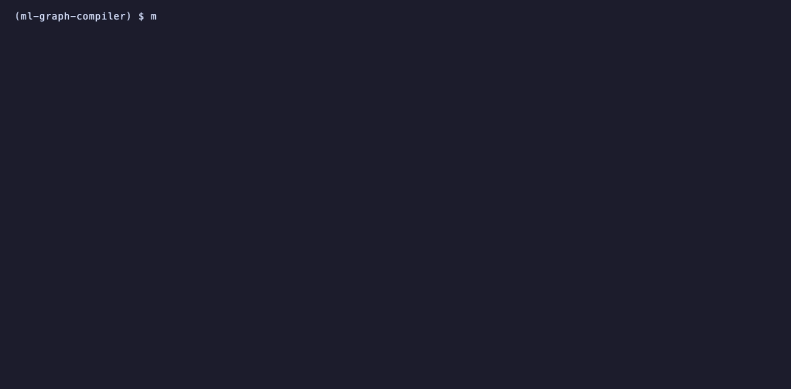

<h1 align="center">ML Graph Compiler</h1>

<p align="center">
  <em>A deep learning graph compiler: ONNX models in, an SSA graph IR through optimization passes and a static memory planner, native code out through generated C and clang, with an MLIR export.</em>
</p>

<p align="center">
  <a href="https://github.com/adeoluo/ml-graph-compiler/actions/workflows/ci.yml"></a>
  <a href="https://github.com/adeoluo/ml-graph-compiler/releases"></a>
  
  
  <a href="LICENSE"></a>
</p>

---

## Motivation

Inference runtimes such as onnxruntime, TVM and XLA all solve the same problem: take a dataflow
graph exported from a training framework and turn it into fast code for one machine. The hard
parts are not the arithmetic but the transformations in between: deciding which operators to
fuse, which layout each tensor should have, in what order to run the nodes, and how to fit every
intermediate tensor into as little memory as possible, all while keeping the outputs equal to
the original model within float rounding.

This project implements that pipeline end to end and measures it on four real networks
(ResNet-50, MobileNetV2, BERT-base and GPT-2). An ONNX importer builds a typed SSA graph with
static shapes; constant folding, dead code elimination, CSE, algebraic simplification, operator
fusion, an NCHW to NHWC layout pass and loop fusion rewrite it; a memory-aware scheduler orders
it and a static planner packs every tensor into one arena; the backend emits C with a NEON GEMM
micro-kernel and OpenMP, builds it with clang and loads it through ctypes. A numpy interpreter
runs any graph as the reference, and an MLIR export (linalg on tensors) is verified with
`mlir-opt` and can be lowered to LLVM and run.

## Architecture

<p align="center">
  
</p>

<sub>Legend: amber = entry points and external systems, indigo = core logic, green = data and state, blue = validation and control, grey = observability and outputs.</sub>

A model enters through the `mgc` CLI or the library API. The **frontend** parses the ONNX
protobuf into SSA values and nodes, and shape inference gives every value a static shape and
dtype using one operator table that also holds each operator's numpy semantics. The
**optimizer** runs a named pipeline (`O0` to `O3`) of passes, each verified after it runs; the
**scheduler** picks an order that lowers peak live memory, and the **memory planner** computes
liveness and assigns arena offsets with in-place reuse. The **backends** either interpret the
graph with numpy, print it as MLIR, or generate one C function with constant offsets into the
arena and a packed weights blob, which clang compiles into a cached shared library. Stage by
stage detail is in [docs/ARCHITECTURE.md](docs/ARCHITECTURE.md); design choices are in the
[ADRs](docs/adr/).

## Results

All numbers below were produced on one Apple M1 laptop (8 cores, 8 GB, macOS) with float32,
batch 1, images 224x224 and 128 tokens, by the scripts in [`benchmarks/`](benchmarks/). Raw
results are in [`benchmarks/results/`](benchmarks/results/), and
`uv run python benchmarks/tables.py` prints every table here from them. Library versions:
numpy 2.5.4, onnx 1.23.2, onnxruntime 1.31.1 (CPU execution provider), PyTorch 2.15.0,
torchvision 0.29.2 and transformers 5.22.2 (text model exports and the PyTorch baselines), Apple
clang 21 with Homebrew libomp. The full write-up, including threats to validity, is
[docs/EVALUATION_REPORT.md](docs/EVALUATION_REPORT.md).

### Numerical parity with onnxruntime

Compiled at `-O3` with the C backend, each model is compared with onnxruntime on the same ONNX
file. Images are the full Imagenette validation split (3,925 ImageNet photos); the text models
get 50 seeded random sequences of 128 tokens (6,400 token positions each).
Reproduce: `uv run --group bench python benchmarks/parity.py`.

| Model | Inputs | Max abs error | Mean abs error | Top-1 agreement | Top-1 accuracy (mgc / ORT) |
|---|---|---:|---:|---:|---:|
| ResNet-50 | 3,925 imagenette2-320 val images | 4.0e-05 | 1.1e-06 | 3,925 / 3,925 | 0.8471 / 0.8471 |
| MobileNetV2 | 3,925 imagenette2-320 val images | 5.0e-05 | 2.5e-06 | 3,925 / 3,925 | 0.7903 / 0.7903 |
| BERT-base | 50 random token ids, seq 128 | 2.9e-05 | 4.6e-07 | 6,400 / 6,400 | n/a |
| GPT-2 | 50 random token ids, seq 128 | 2.2e-04 | 2.2e-05 | 6,400 / 6,400 | n/a |

Every compiled model picks the same top-1 class as onnxruntime at every image and token
position, and the image models reach the same Imagenette top-1 accuracy. The unoptimized graph
run by the numpy interpreter (`O0`) also matches onnxruntime (max abs error 1.5e-05 to 2.6e-04
on a subset), so each pass is checked against both references. The text models are exported with
transformers 5.22.2; its graphs differ from the 4.57.6 exports (BERT-base 1,212 instead of 1,266
ONNX nodes, GPT-2 2,043 instead of 2,127) but give bit-identical onnxruntime outputs on the 50
sequences and compile at `-O3` to the same node and kernel counts
([`export_transformers5.json`](benchmarks/results/export_transformers5.json),
`benchmarks/compare_exports.py`).

### Latency and peak memory against onnxruntime and PyTorch

Median latency of one inference in milliseconds with a bootstrap 95% confidence interval, and
the median peak resident set size of the process in MB. Every cell runs in a fresh process;
cells are interleaved round robin for 3 rounds (30 timed runs per round for the CNNs, 10 for
the transformers) and the samples are pooled. "onnxruntime" uses all its graph optimizations;
"no graph opt" disables them, which isolates its kernels. A win or loss is called only when the
two confidence intervals do not overlap.
Reproduce: `uv run --group bench python benchmarks/latency.py --models resnet50 mobilenetv2 --name latency_cnn`
and `... --models bert-base gpt2 --warmup 3 --repeat 10 --name latency_transformers`.

latency_cnn (latency_cnn): 48 cells, 1 minute load average during the cells min 3.2, median 3.4, max 4.0 (8 cores)
latency_transformers (latency_transformers): 48 cells, 1 minute load average during the cells min 3.0, median 5.0, max 8.2 (8 cores)

Threads = 1: median ms [95% CI] (peak RSS MB)

| Model | mgc (this) | onnxruntime | onnxruntime, no graph opt | PyTorch eager | mgc vs ORT | mgc vs PyTorch |
|---|---:|---:|---:|---:|---|---|
| ResNet-50 | 113.9 [113.8, 114.1] (596) | 101.4 [101.2, 101.6] (285) | 103.3 [103.3, 103.5] (204) | 31.3 [31.2, 31.5] (486) | loss, 1.12x slower | loss, 3.64x slower |
| MobileNetV2 | 13.3 [13.3, 13.3] (138) | 11.6 [11.6, 11.7] (114) | 12.3 [12.3, 12.4] (112) | 14.6 [14.6, 14.7] (323) | loss, 1.15x slower | win, 1.10x |
| BERT-base | 290.9 [290.7, 291.3] (1074) | 256.9 [256.4, 257.9] (957) | 304.3 [304.0, 304.7] (1111) | 52.4 [52.1, 52.5] (668) | loss, 1.13x slower | loss, 5.56x slower |
| GPT-2 | 415.4 [414.6, 415.9] (1592) | 357.2 [356.9, 357.7] (1032) | 399.4 [398.9, 399.6] (1040) | 97.3 [96.4, 100.2] (846) | loss, 1.16x slower | loss, 4.27x slower |

Threads = 8: median ms [95% CI] (peak RSS MB)

| Model | mgc (this) | onnxruntime | onnxruntime, no graph opt | PyTorch eager | mgc vs ORT | mgc vs PyTorch |
|---|---:|---:|---:|---:|---|---|
| ResNet-50 | 29.8 [29.7, 30.0] (597) | 40.9 [40.1, 41.9] (287) | 41.6 [41.0, 42.5] (204) | 28.1 [28.0, 28.2] (487) | win, 1.37x | loss, 1.06x slower |
| MobileNetV2 | 6.0 [5.9, 6.0] (138) | 6.0 [5.7, 6.3] (116) | 7.3 [6.8, 7.6] (113) | 43.6 [43.5, 43.9] (324) | tie | win, 7.33x |
| BERT-base | 72.0 [71.6, 73.2] (1257) | 88.8 [85.9, 103.1] (956) | 127.1 [122.6, 130.5] (1086) | 54.5 [53.3, 55.8] (670) | win, 1.23x | loss, 1.32x slower |
| GPT-2 | 109.7 [106.0, 120.4] (1833) | 149.4 [138.9, 199.9] (1031) | 165.3 [145.8, 188.5] (1041) | 91.5 [90.6, 103.8] (847) | win, 1.36x | loss, 1.20x slower |

All cells ran on the unloaded 8-core Apple M1 (1-minute load average median 3.4 for CNNs, 5.0
for transformers, well within the 8 cores). Every engine scales cleanly from 1 to 8 threads
except PyTorch eager on MobileNetV2 (where depthwise separable convolutions suffer thread-pool
synchronization overhead at batch 1) and PyTorch eager on the transformers (which dispatches GEMM
to Apple Accelerate AMX coprocessor blocks and already saturates at `threads=1`).

At **8 threads**, the compiled C + OpenMP + NEON code beats `onnxruntime` CPU on three of four
models (**1.37x** on ResNet-50, **1.23x** on BERT-base, **1.36x** on GPT-2) and **ties** on
MobileNetV2 (`6.0 ms` vs `6.0 ms`). At **1 thread**, `onnxruntime`'s hand-tuned MLAS assembly
kernels are **1.12x to 1.16x faster** than `mgc`'s portable NEON micro-kernel across all four
models. Against PyTorch eager, `mgc` wins on MobileNetV2 (`1.10x` at 1 thread, `7.33x` at 8
threads), comes within `6%` on 8-thread ResNet-50 (`29.8 ms` vs `28.1 ms`), and trails PyTorch's
Apple Accelerate AMX backend on BERT-base and GPT-2 (`1.20x - 1.32x` at 8 threads, `4.27x - 5.56x`
single-threaded).

### Effect of each pass

Cumulative pipelines, each adding one group of passes to the previous one, compiled with the C
backend; nodes, generated kernels, arena size, median latency and the max abs error against
onnxruntime. Leave-one-out runs `O3` with one pass removed. CNN runs use 2 rounds of 10 timed
runs per thread count, transformer runs 2 rounds of 5.
Reproduce: `uv run --group bench python benchmarks/ablation.py --models resnet50 mobilenetv2 --name ablation_cnn`
and `... --models bert-base gpt2 --repeat 5 --name ablation_transformers`.

cumulative: nodes, arena MB, median ms at 1 / 8 threads, max abs err vs ORT

| Model | Config | Nodes | Arena MB | ms, 1 thread | ms, 8 threads | Max abs err |
|---|---|---:|---:|---:|---:|---:|
| ResNet-50 | O0 | error: CodegenError: BatchNormalization parameters must be constant | | | | |
| ResNet-50 | fold | 175 | 9.2 | 200.2 | 54.0 | 2.9e-06 |
| ResNet-50 | cse | 175 | 9.2 | 200.8 | 53.3 | 2.9e-06 |
| ResNet-50 | simplify | 175 | 9.2 | 199.3 | 53.1 | 2.9e-06 |
| ResNet-50 | fuse | 57 | 6.9 | 205.9 | 52.5 | 1.9e-06 |
| ResNet-50 | layout | 58 | 6.9 | 114.1 | 30.8 | 2.9e-06 |
| ResNet-50 | loopfuse | 58 | 6.9 | 113.8 | 30.3 | 2.9e-06 |
| MobileNetV2 | O0 | 152 | 9.2 | 54.0 | 17.7 | 9.5e-06 |
| MobileNetV2 | fold | 152 | 9.2 | 54.0 | 17.6 | 9.5e-06 |
| MobileNetV2 | cse | 152 | 9.2 | 54.0 | 17.7 | 9.5e-06 |
| MobileNetV2 | simplify | 152 | 9.2 | 51.8 | 17.1 | 9.5e-06 |
| MobileNetV2 | fuse | 55 | 5.7 | 42.4 | 13.8 | 6.0e-06 |
| MobileNetV2 | layout | 56 | 5.7 | 13.3 | 6.1 | 6.6e-06 |
| MobileNetV2 | loopfuse | 56 | 5.7 | 13.3 | 6.0 | 6.6e-06 |
| BERT-base | O0 | 905 | 11.2 | 410.0 | 127.0 | 1.6e-05 |
| BERT-base | fold | 675 | 11.2 | 408.5 | 126.9 | 1.6e-05 |
| BERT-base | cse | 675 | 11.2 | 417.1 | 140.5 | 1.6e-05 |
| BERT-base | simplify | 675 | 11.2 | 414.4 | 132.8 | 2.1e-05 |
| BERT-base | fuse | 246 | 2.2 | 292.8 | 109.3 | 1.7e-05 |
| BERT-base | layout | 246 | 2.2 | 291.6 | 75.6 | 1.7e-05 |
| BERT-base | loopfuse | 245 | 2.2 | 291.2 | 74.4 | 1.7e-05 |
| GPT-2 | O0 | 1248 | 147.6 | 593.5 | 252.5 | 9.9e-05 |
| GPT-2 | fold | 675 | 147.6 | 588.8 | 254.1 | 9.9e-05 |
| GPT-2 | cse | 675 | 147.6 | 589.3 | 261.8 | 9.9e-05 |
| GPT-2 | simplify | 661 | 147.6 | 563.2 | 246.4 | 1.1e-04 |
| GPT-2 | fuse | 244 | 3.0 | 443.3 | 111.6 | 1.1e-04 |
| GPT-2 | layout | 244 | 3.0 | 428.7 | 111.2 | 1.1e-04 |
| GPT-2 | loopfuse | 232 | 3.0 | 415.4 | 110.8 | 1.1e-04 |

leave_one_out: nodes, arena MB, median ms at 1 / 8 threads, max abs err vs ORT

| Model | Config | Nodes | Arena MB | ms, 1 thread | ms, 8 threads | Max abs err |
|---|---|---:|---:|---:|---:|---:|
| ResNet-50 | O3 | 58 | 6.9 | 114.0 | 29.9 | 2.9e-06 |
| ResNet-50 | O3-no-fold | 58 | 6.9 | 113.9 | 30.0 | 2.9e-06 |
| ResNet-50 | O3-no-cse | 58 | 6.9 | 114.0 | 30.0 | 2.9e-06 |
| ResNet-50 | O3-no-simplify | 58 | 6.9 | 114.0 | 30.2 | 2.9e-06 |
| ResNet-50 | O3-no-fuse | 162 | 9.2 | 197.8 | 52.4 | 2.9e-06 |
| ResNet-50 | O3-no-layout | 57 | 6.9 | 205.6 | 50.6 | 1.9e-06 |
| ResNet-50 | O3-no-loopfuse | 58 | 6.9 | 114.1 | 30.2 | 2.9e-06 |
| MobileNetV2 | O3 | 56 | 5.7 | 13.2 | 6.0 | 6.6e-06 |
| MobileNetV2 | O3-no-fold | 56 | 5.7 | 13.2 | 6.0 | 6.6e-06 |
| MobileNetV2 | O3-no-cse | 56 | 5.7 | 13.3 | 6.0 | 6.6e-06 |
| MobileNetV2 | O3-no-simplify | 56 | 5.7 | 13.3 | 6.1 | 6.6e-06 |
| MobileNetV2 | O3-no-fuse | 153 | 9.2 | 38.8 | 14.6 | 9.5e-06 |
| MobileNetV2 | O3-no-layout | 55 | 5.7 | 42.4 | 13.9 | 6.0e-06 |
| MobileNetV2 | O3-no-loopfuse | 56 | 5.7 | 13.3 | 6.0 | 6.6e-06 |
| BERT-base | O3 | 245 | 2.2 | 291.4 | 77.1 | 1.7e-05 |
| BERT-base | O3-no-fold | 247 | 2.2 | 291.0 | 76.6 | 1.7e-05 |
| BERT-base | O3-no-cse | 245 | 2.2 | 292.4 | 76.4 | 1.7e-05 |
| BERT-base | O3-no-simplify | 245 | 2.2 | 291.3 | 76.3 | 1.7e-05 |
| BERT-base | O3-no-fuse | 515 | 11.2 | 404.9 | 122.4 | 1.9e-05 |
| BERT-base | O3-no-layout | 245 | 2.2 | 293.1 | 76.0 | 1.7e-05 |
| BERT-base | O3-no-loopfuse | 246 | 2.2 | 291.4 | 76.7 | 1.7e-05 |
| GPT-2 | O3 | 232 | 3.0 | 418.8 | 103.7 | 1.1e-04 |
| GPT-2 | O3-no-fold | 233 | 3.0 | 416.0 | 105.3 | 1.1e-04 |
| GPT-2 | O3-no-cse | 232 | 3.0 | 415.3 | 106.3 | 1.1e-04 |
| GPT-2 | O3-no-simplify | 378 | 3.0 | 418.6 | 105.2 | 1.1e-04 |
| GPT-2 | O3-no-fuse | 478 | 147.6 | 560.1 | 237.5 | 9.9e-05 |
| GPT-2 | O3-no-layout | 232 | 3.0 | 415.5 | 106.2 | 1.1e-04 |
| GPT-2 | O3-no-loopfuse | 244 | 3.0 | 415.0 | 103.7 | 1.1e-04 |

The `O3` / `loopfuse` rows in both ablation studies agree closely with the independent subprocess
latency table (`ResNet-50` `113.8-114.0 ms` t=1 / `29.9-30.3 ms` t=8; `MobileNetV2` `13.2-13.3 ms`
t=1 / `6.0 ms` t=8; `BERT-base` `291.2-291.4 ms` t=1 / `74.4-77.1 ms` t=8; `GPT-2` `415.4-418.8 ms`
t=1 / `103.7-110.8 ms` t=8).

Two passes carry most of the speed. Operator fusion folds BatchNorm into convolutions and merges
bias, residual and activation epilogues into the GEMM: it removes 63% to 67% of the nodes
(ResNet-50 175 to 57, MobileNetV2 152 to 55, BERT-base 675 to 246, GPT-2 661 to 244) and
shrinks the arena (GPT-2 from 147.6 MB to 3.0 MB: the output projection reads the 50257 x 768
embedding matrix through a transpose, which FusedGemm absorbs instead of materializing). Removing
fusion from `O3` slows 8-thread inference by **1.75x** on ResNet-50, **2.43x** on MobileNetV2,
**1.59x** on BERT-base, and **2.29x** on GPT-2. The NHWC layout pass is what makes the convolution
GEMMs fast: removing it from `O3` slows MobileNetV2 **3.21x** (t=1) / **2.32x** (t=8) and ResNet-50
**1.80x** (t=1) / **1.69x** (t=8). Constant folding is required for the C backend on ResNet-50
(BatchNorm parameters must be constants) and removes 25% of the BERT-base and 46% of the GPT-2
nodes, mostly shape arithmetic. Every configuration stays within 1.2e-04 of onnxruntime.

### Memory planning

Arena size in MB for each placement strategy on the `O3` graph. Peak live is the largest total
size of tensors alive at the same step: in the importer's order, and after the memory-aware
scheduler (the lower bound for any placement in that order). Naive gives every tensor its own
buffer. Weights are not in the arena.

Arena MB by planner (scheduled graph, O3)

| Model | Peak live, import order | Peak live, scheduled (lower bound) | naive (no reuse) | first_fit | greedy_by_size | greedy_by_size + in place |
|---|---:|---:|---:|---:|---:|---:|
| ResNet-50 | 6.9 | 6.9 | 43.7 | 10.5 | 6.9 | 6.9 |
| MobileNetV2 | 5.7 | 5.7 | 26.1 | 6.5 | 5.7 | 5.7 |
| BERT-base | 2.2 | 2.2 | 99.8 | 2.6 | 2.2 | 2.2 |
| GPT-2 | 24.9 | 2.6 | 113.6 | 3.0 | 3.0 | 3.0 |

The greedy by size planner reaches the lower bound on three of the four models and is within
0.4 MB on GPT-2. The scheduler matters most on GPT-2: the memory-aware order
cuts peak live memory from 24.9 MB to 2.6 MB, and the arena from 113.6 MB with no reuse
to 3.0 MB. In-place reuse does not change the arena at `O3` on these models.

### MLIR export

Each model is exported as linalg on tensors with weights elided and checked by `mlir-opt`
(LLVM 23 from Homebrew); operators without a linalg lowering would stay as generic `mgc`
operations. MobileNetV2 was also lowered all the way (one-shot bufferization, loops, LLVM
dialect), built with clang and run. Reproduce: `uv run --group bench python benchmarks/mlir_models.py --execute mobilenetv2`.

| Model | Level | Nodes | MLIR lines | Ops left in mgc dialect | Verified by mlir-opt |
|---|---|---:|---:|---|---|
| ResNet-50 | O0 | 179 | 2,137 | none | yes |
| ResNet-50 | O3 | 58 | 1,216 | none | yes |
| MobileNetV2 | O0 | 152 | 2,011 | none | yes |
| MobileNetV2 | O3 | 56 | 1,224 | none | yes |
| BERT-base | O0 | 905 | 5,773 | none | yes |
| BERT-base | O3 | 245 | 3,469 | none | yes |
| GPT-2 | O0 | 1,248 | 6,633 | none | yes |
| GPT-2 | O3 | 232 | 3,131 | none | yes |

| Model | Lowered and built (s) | Max abs err vs ORT | Top-1 agrees | ms, 1 thread |
|---|---:|---:|---|---:|
| MobileNetV2 | 13 | 1.0e-05 | yes | 291 |

Every model lowers completely to standard dialects at both levels (the transformers 4.57.6
BERT-base export left one `ConstantOfShape` in the mgc dialect at `O0`; the 5.22.2 export no
longer has it). The lowered MobileNetV2 matches onnxruntime, but at 291 ms single threaded it is
more than 15 times slower than the C backend (16.0 ms in the latency table): the default MLIR
lowering emits naive loops with no tiling or vectorization, which is the work the C backend's
packed GEMM does by hand.

## Quickstart

```bash
git clone https://github.com/adeoluo/ml-graph-compiler && cd ml-graph-compiler
uv sync --dev                                   # Python 3.12+, clang on the PATH
uv run mgc compile tiny-cnn --check --bench 50  # build a bundled model, compare, time it
```

On macOS, `brew install libomp` enables OpenMP (the build falls back to one thread without it);
`brew install llvm` provides `mlir-opt` for the MLIR checks. Linux needs `clang` or `gcc`.

## Usage

### Command line

```bash
uv run mgc inspect model.onnx                       # graph summary, operator counts, shapes
uv run mgc optimize model.onnx -O O3                # run a pipeline, report every pass
uv run mgc optimize model.onnx -O fold,cse,fuse     # or any list of passes
uv run mgc plan model.onnx                          # schedule and arena size per strategy
uv run mgc run model.onnx -O O2                     # numpy interpreter, compare with O0
uv run mgc compile model.onnx --check --bench 100 --threads 8 -o build/
uv run mgc compile model.onnx --emit-c model.c      # keep the generated C
uv run mgc mlir model.onnx --verify -o model.mlir   # linalg on tensors, checked by mlir-opt
```

`model` is an ONNX file or a bundled sample (`mlp`, `tiny-cnn`, `tiny-gpt`, `tiny-bert`).
Symbolic dimensions are bound with `--dim batch=1` or `--shape input_ids=1x128`. Every command
accepts `--json`.

### Library

```python
import numpy as np
from ml_graph_compiler.codegen import compile_model
from ml_graph_compiler.interpreter import run_graph
from ml_graph_compiler.onnx_import import from_onnx
from ml_graph_compiler.samples import tiny_cnn

model = tiny_cnn()
compiled = compile_model(model, opt="O3")  # import, optimize, schedule, generate C, clang
name, ttype = compiled.inputs[0]
x = np.random.default_rng(0).standard_normal(ttype.shape, dtype=np.float32)
out = compiled.run({name: x})

reference = run_graph(from_onnx(model), {name: x})  # numpy interpreter, unoptimized graph
print({k: float(np.abs(out[k] - reference[k]).max()) for k in out})  # {'logits': 9.5e-07}
```

The stages are also usable one at a time: `from_onnx`, `passes.optimize(graph, "O3")`,
`schedule.schedule(graph)`, `memory.plan_memory(graph)`, `codegen.compile_graph(graph)` and
`mlir.to_mlir(graph)`.

### Benchmarks and data

`uv sync --group bench` adds PyTorch, torchvision and transformers.
`benchmarks/export_models.py` downloads the four checkpoints and exports them to ONNX at
opset 14 with static shapes; `benchmarks/parity.py` downloads Imagenette (about 100 MB). Data
and weights go to `../.bench-data/ml-graph-compiler/` (override with `MGC_DATA`). See
[docs/DATA_CARD.md](docs/DATA_CARD.md).

### Demos

Recorded from real runs with [vhs](https://github.com/charmbracelet/vhs); each tape is in `docs/demo/`.

The `O3` pipeline on MobileNetV2: what each pass changed, and the operators before and after.

<p align="center">
  
</p>

Scheduling and memory planning for ResNet-50: arena size per placement strategy.

<p align="center">
  
</p>

Compiling MobileNetV2 to C with clang, checking it against the interpreter and timing it.

<p align="center">
  
</p>

Exporting a small transformer to MLIR and verifying it with mlir-opt.

<p align="center">
  
</p>

## Design decisions

- **An SSA graph IR with static shapes and one operator table**
  ([ADR-0002](docs/adr/0002-ssa-ir-with-static-shapes.md)). Every value has one producer and a
  known shape, so passes can rewrite locally and the planner can size every buffer ahead of
  time. Shape inference and the interpreter share the operator table, so a pass is checked
  against the same semantics it was written for. The cost: one compilation per input shape.
- **One static arena, greedy by size** ([ADR-0003](docs/adr/0003-static-arena-memory-planning.md)).
  Tensors are placed largest first into the lowest offset that does not overlap a tensor alive
  at the same time, with in-place reuse for elementwise ops; the plan is verified pairwise.
  No allocation happens at run time.
- **Generate C and build it with clang** ([ADR-0004](docs/adr/0004-c-code-generation-with-clang.md)).
  C is portable, debuggable and lets clang do register allocation and vectorization; the hot
  GEMM is a hand written NEON micro-kernel over packed weight panels, with a portable fallback.
- **NHWC inside convolution regions** ([ADR-0005](docs/adr/0005-nhwc-layout-transformation.md)).
  Channels last makes the implicit im2col GEMM read contiguous memory; transposes are sunk and
  cancelled so only region boundaries pay for them.
- **MLIR as a textual export** ([ADR-0006](docs/adr/0006-mlir-textual-export.md)). The graph is
  printed as linalg on tensors (with an `mgc` dialect fallback), verified by `mlir-opt` and
  optionally lowered through bufferization to LLVM, without linking MLIR's C++ API.

## Testing

```bash
uv run pytest                                                  # full suite
uv run pytest --cov=src --cov-report=term-missing              # with coverage (CI gate 80%)
make all                                                       # lint, types, coverage
```

666 tests (94% line and branch coverage) cover:

- **Operators**: shape and type inference and numpy semantics for every supported operator,
  compared with onnxruntime on generated single node models.
- **Passes**: each pass on targeted graphs and on the bundled models, with outputs compared
  against the interpreter and onnxruntime before and after; property based tests (hypothesis)
  run random elementwise graphs through every pipeline and check the values are unchanged.
- **Memory and scheduling**: plans on random DAGs (hypothesis) never overlap and greedy by size
  is never worse than naive; schedules stay topological; aliasing and in-place rules.
- **C backend**: every kernel against the interpreter with and without OpenMP and NEON,
  input validation, bounds checked Gather, and hostile node names that try to escape comments.
- **MLIR**: text for every operator, verification by `mlir-opt` and lowered execution when the
  LLVM tools are installed (skipped otherwise).
- **CLI**: every subcommand on the bundled samples.

The real model parity, latency and ablation runs are scripts rather than tests because they need
the downloaded weights and minutes to hours of compute.

CI runs the suite on Python 3.12, 3.13 and 3.14. Python 3.15 is not in the matrix yet:
onnxruntime, the reference most operator and backend tests compare against, publishes no 3.15
wheels (1.31.1 is the latest release), so the suite cannot run there.

## Responsible AI

- **Model card:** [`docs/MODEL_CARD.md`](docs/MODEL_CARD.md)
- **Data card:** [`docs/DATA_CARD.md`](docs/DATA_CARD.md)
- **Threat model:** [`docs/THREAT_MODEL.md`](docs/THREAT_MODEL.md). A compiled model is native
  code loaded into the calling process; model supplied names never reach generated code
  unescaped, indices are bounds checked, and untrusted models should be compiled in a sandbox.

## Limitations

- Static shapes only: a model with a symbolic batch or sequence length is compiled for one
  binding at a time. No dynamic shapes, control flow (`If`, `Loop`) or quantized operators.
- CPU only (NEON on Apple silicon and ARM Linux, portable C elsewhere); no GPU backend.
- Single threaded, ResNet-50 is 3.66x slower than PyTorch eager, whose convolutions use a tuned
  vendor library, and BERT-base and GPT-2 are 2.0x to 2.6x slower than onnxruntime; the
  generated GEMM is one micro-kernel shape without autotuning.
- Attention is lowered as separate MatMul, Softmax and MatMul kernels, not a fused
  attention kernel.
- The latency numbers come from a heavily loaded shared laptop (see the load averages above).
- Imagenette is a 10 class subset; text models are fed random token ids, not natural text.

## Roadmap

- [ ] Autotune GEMM tile sizes per shape and add an int8 kernel path.
- [ ] Fused attention (tiled softmax) for the transformer models.
- [ ] Dynamic batch dimension with shape specialised kernels chosen at run time.
- [ ] Rerun the latency tables on an idle machine.

## License

Released under the [MIT License](LICENSE).
