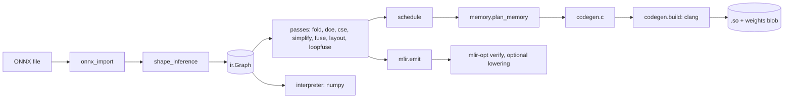

# Architecture

The compiler is a straight pipeline over one in-memory graph. Each stage is a module under
`src/ml_graph_compiler/`.

## Stages

| Stage | Module | What it does |
|---|---|---|
| Import | `onnx_import.py` | Protobuf to SSA values and nodes; rejects foreign domains and opsets outside 11 to 21; binds symbolic dimensions |
| Shape and type inference | `shape_inference.py`, `ops.py` | One registry gives each operator a type rule and numpy semantics; small integer shape computations are evaluated so Reshape targets become constants |
| Constant folding, DCE, CSE | `passes/basic.py` | Evaluates nodes whose inputs are all constant with the same numpy semantics; removes unused nodes; merges identical nodes by (op, inputs, attributes) |
| Algebraic simplification | `passes/simplify.py` | Removes identities, rewrites powers and divisions, collapses reshape and transpose chains |
| Operator fusion | `passes/fusion.py` | Conv + BatchNorm folding; FusedConv and FusedGemm with bias, residual and activation epilogues; LayerNorm and GELU pattern recognition |
| Layout | `passes/layout.py` | NCHW convolution regions to NHWC, transpose sinking and cancellation |
| Loop fusion | `passes/loopfuse.py` | Chains of elementwise ops into one FusedElementwise loop |
| Scheduling | `schedule.py` | Memory-aware greedy list scheduling, wavefront levels, critical path FLOPs |
| Memory planning | `memory.py` | Alias groups, liveness, in-place reuse, greedy-by-size offsets, plan verification |
| C code generation | `codegen/c.py` | One `mgc_run` function with constant offsets; packed GEMM with an 8x12 NEON micro-kernel; implicit im2col; depthwise kernel; OpenMP over output tiles |
| Build and runtime | `codegen/build.py`, `codegen/runtime_lib.py` | clang with OpenMP probe, content-hashed cache, ctypes loader, memory-mapped weights |
| Reference interpreter | `interpreter.py` | Executes any graph (before or after passes) with the registry semantics |
| MLIR export | `mlir/emit.py`, `mlir/execute.py` | linalg-on-tensors text, mlir-opt verification, optional lowering to LLVM and execution |

## Pass pipelines

`passes.PIPELINES` defines cumulative levels used by the CLI and by the ablation benchmark:
`O0` (none), `fold`, `cse`, `simplify` (= `O1`), `fuse` (= `O2`), `layout`, `loopfuse` (= `O3`).
Every pass returns the number of rewrites it made, and the pass manager verifies the graph (SSA
form, types) after each pass.

## Invariants checked in tests
- Every pass preserves outputs against the reference interpreter and onnxruntime.
- The memory plan never places two simultaneously live buffers at overlapping addresses.
- Generated C matches the interpreter for every supported operator, with and without OpenMP.
- MLIR text parses and verifies with `mlir-opt` when it is installed, and lowered modules
  reproduce the interpreter's outputs.
